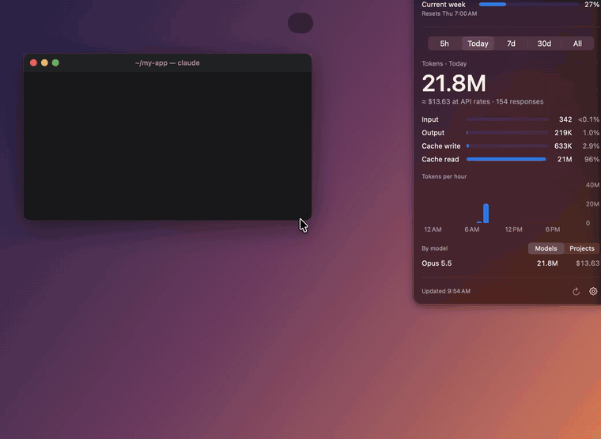

# Claude Kitten 🐾

A tiny pixel kitten that lives on your Mac and nudges you when **Claude Code** finishes a task or needs you, so you never miss it while you're off in another window.



<sub>Higher quality: [docs/demo.mp4](docs/demo.mp4)</sub>

## What it does

- **Nudges you when Claude is done.** The kitten pops out of its box with hearts and a speech bubble showing a preview of Claude's last message and how long it took.
- **Tells you when Claude needs you**, such as a permission prompt, a question, or a plan to approve. It shows a bouncing "!" instead. It waits a few seconds first, so it stays quiet if you answer right away.
- **Doesn't let you miss it.** It hops every 25 seconds and purrs every couple of minutes until you click it, or until you pick that session back up.
- **Shows every session at a glance.** Click the kitten (or the cat in the menu bar) to see all open Claude Code sessions:
  - what each one is doing right now ("Running: npm test", "Editing Theme.swift")
  - your last prompt and Claude's last reply
  - how long it's been
- **Takes you to the right window.** Click a session to jump to its terminal (Terminal, iTerm, Warp, VS Code, the Claude app, and others).
- **Stays out of your way.** Drag the kitten anywhere and pick a size from Tiny to Huge. It kneads while Claude works and naps when everything is idle.
- **Works for any shell command:** `long-command; meow`
- **Always on.** It starts at login, keeps running through sleep and wake, and restarts itself if it ever crashes.

## Requirements

- macOS 14 or later
- Xcode Command Line Tools (`xcode-select --install`), for `swiftc`
- Python 3 (comes with the Command Line Tools)
- [Claude Code](https://docs.claude.com/en/docs/claude-code)

## Install

```sh
git clone https://github.com/irsyadashari/claude-kitten.git
cd claude-kitten
./install.sh
```

`install.sh` does the following:

1. Builds the app with `swiftc`. No Xcode project is needed.
2. Installs it to `~/Applications/ClaudeKitten.app`.
3. Adds Claude Code hooks to every `~/.claude*/settings.json`. It backs up each file first and leaves your other settings and hooks alone.
4. Adds a login item, so the app starts at login and restarts if it crashes.

Look for the little cat in your menu bar. Sessions that are already open are picked up right away.

### Optional: the `meow` command

```sh
sudo ln -s ~/Applications/ClaudeKitten.app/Contents/MacOS/kitten-hook /usr/local/bin/meow

npm run build; meow          # nudge when it's done
meow "coffee time ☕"         # nudge with a message
meow run make test           # run, then nudge with how it went
```

## Settings

Click the kitten to open the sessions panel. The settings are at the bottom:

| Setting | What it does |
|---|---|
| Purr sound | Plays a soft purr with each nudge |
| Keep nudging | Hops every 25 seconds until you click it |
| Open at login | Starts the app at login |
| Kitten size | Tiny, Small, Medium, Big, or Huge |
| Always show the kitten | Keeps it on screen, resting in its box. Turn it off to have it appear only for nudges |
| Stay quiet if I'm already looking at that terminal | Skips nudges for the window you're already in |
| Put kitten back in the corner | Moves the kitten back to the bottom-right corner |

## How it works

- **Session list.** Claude Code keeps a small registry of running sessions (`~/.claude*/sessions/<pid>.json`) with each session's status. The app reads it every second to know what's open and what's busy.
- **Details and nudges.** The `kitten-hook` helper runs on Claude Code hook events (`UserPromptSubmit`, `PreToolUse`, `Stop`, `Notification`, and others). It writes small state files to `~/Library/Application Support/ClaudeKitten/`, which give the details: the current tool, your last prompt, Claude's reply, and permission prompts.
- **Local only.** Nothing leaves your Mac. There's no network access and no analytics.

Want to see the demo again? Run `~/Applications/ClaudeKitten.app/Contents/MacOS/ClaudeKitten --demo`. It plays the scripted walkthrough with made-up sessions and doesn't touch your settings.

## Uninstall

```sh
./uninstall.sh
```

This removes the app, the login item, its data, and its hooks. All your other Claude Code settings are kept.

---

Made with 🧡 for anyone who keeps tabbing away while Claude works. Not affiliated with Anthropic.
